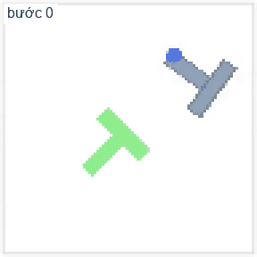

# Push-T: World Model + Diffusion Policy

Robot (một chấm tròn 2D) đẩy khối chữ T vào vùng đích, chỉ nhìn qua **ảnh 96 × 96**. Project xây dựng một **world model**
đọc trạng thái từ ảnh và **dự đoán khối T sẽ di chuyển thế nào** khi robot hành động, rồi dùng nó để **chọn kế hoạch tốt nhất**
trong các đề xuất của một **Diffusion Policy**.

> Đề bài: *xây dựng World Model — từ trạng thái hiện tại và hành động của robot, dự đoán sự thay đổi vị trí vật thể.*

<p align="center">
  <br>
  <em>Mô hình chính đẩy khối T (xám) vào vùng đích (xanh lá) — 4 màn trong tập test, chạy từ ảnh, xem nhanh ×2.</em>
</p>

```
ảnh ─► WM encoder ─► s_t ─► Diffusion ─► 16 path ─► WM dynamics tưởng tượng hậu quả ─► chọn path ─► mô hình nghịch ─► action
```

## Kết quả chính

| | Kết quả |
|---|---|
| **World model** dự đoán vị trí khối T sau 16 bước khi đang bị đẩy (tập chưa từng thấy) | lệch **1.99 đv / 0.21°** — giảm **93%** sai số so với "đoán đứng yên" |
| **Đẩy khối T**, 500 màn test, chuẩn Push-T (≤ 300 bước) | **89.8%** thành công, trung vị **14.3 s** |
| Cùng mô hình, cho tới 1000 bước | **97.4%** thành công |
| Đối chứng: Diffusion 1 path, không có WM chọn | 86.0%, 17.6 s |
| Diffusion Policy gốc đọc thẳng ảnh (bản tự cài lại) | 64.8%, 19.0 s |

<p align="center">
  <br>
  <em>Kiểu thua phổ biến nhất (52%): khối T chỉ lệch vài đơn vị, coverage ~0.9 &lt; 0.95, hết 300 bước.</em>
</p>

## Thành phần

| | Kiến trúc | Vai trò | Checkpoint |
|---|---|---|---|
| WM encoder | ResNet18 | ảnh → vị trí, góc khối T | `models/pose_net.pt` |
| WM dynamics | MLP 4 × 512 | (trạng thái, hành động) → trạng thái kế tiếp | `models/state_wm.pt` |
| Diffusion | U-Net 1D, DDPM/DDIM | trạng thái → 16 đường đi tương lai | `models/path_policy.pt` (Git LFS) |
| Mô hình nghịch | MLP 3 × 512 | đường đi → hành động | `models/inverse.pt` |

## Chạy thử

```bash
git lfs install                      # trước khi clone (path_policy.pt 252 MB dùng Git LFS)
git clone <url repo> && cd <thư mục>
python -m venv .venv
.venv/Scripts/python -m pip install torch torchvision --index-url https://download.pytorch.org/whl/cu126   # Linux: .venv/bin/python
.venv/Scripts/python -m pip install -r requirements.txt
.venv/Scripts/python app_pusht.py    # app: kéo khối T, bấm SPACE để mô hình đẩy
```
Không có GPU vẫn chạy app được (cài torch bản CPU). Đánh giá: `python scripts/eval_state_dp.py`.
Train lại: `bash scripts/run_main.sh` (cần thêm dữ liệu `data/sim_v1.npz`, `data/sim_v2.npz` — không có trong repo vì dung lượng lớn;
`data/pusht_raw.npz` tự tải từ Hugging Face `lerobot/pusht` lần đầu chạy).

## Cấu trúc

```
app_pusht.py        app xem mô hình đẩy khối T và "suy nghĩ" của nó
assets/             ảnh động cho README (tạo bằng scripts/make_gifs.py)
models/             4 checkpoint của mô hình chính
pusht_wm/           code mô hình (encoder, world model, diffusion, mô hình nghịch, chọn path, đánh giá)
scripts/            train / đánh giá / phân tích
results/            kết quả gốc (json, log, video màn thua)
data/demo_state.npz nhãn khối T của 206 demo (dữ liệu lớn khác không nằm trong repo)
```

Dựa trên: Chi et al., *Diffusion Policy: Visuomotor Policy Learning via Action Diffusion* (2023); dữ liệu `lerobot/pusht`;
môi trường `gym-pusht`.
