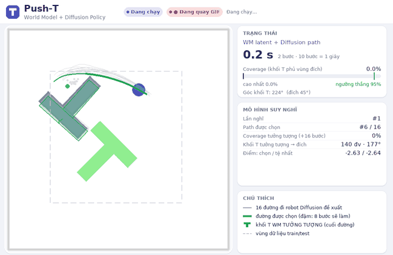
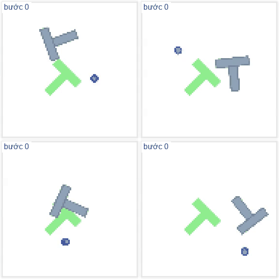
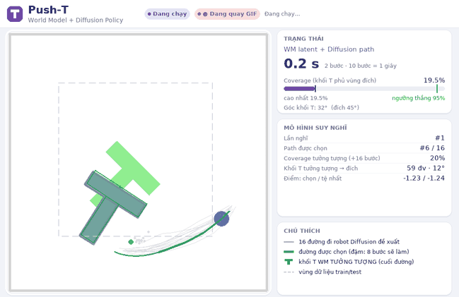
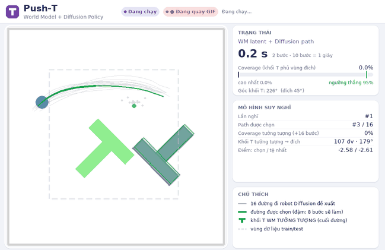

# Mô hình thế giới trong không gian latent cho bài toán đẩy vật Push-T

## Tóm tắt

Đề tài xây dựng một mô hình thế giới (world model) học quy luật tương tác giữa robot và vật thể trong bài toán Push-T:
từ quan sát ảnh hiện tại và chuỗi hành động của robot, mô hình dự đoán sự thay đổi vị trí và góc quay của khối chữ T.
Trạng thái $s_t$ được biểu diễn hoàn toàn trong không gian latent, gồm đặc trưng DINOv2 đã giảm chiều của hai khung
hình gần nhất. Tư thế khối T lấy từ bộ mô phỏng chỉ đóng vai trò tín hiệu giám sát, thông qua sai số điểm cuối
(FDE) trong hàm mất mát. Mô hình thế giới được dùng làm bộ đánh giá cho một mô hình Diffusion sinh quỹ đạo robot.
Quỹ đạo được chuyển thành lệnh điều khiển bằng nghịch đảo giải tích của bộ điều khiển PD. Hai mô hình được huấn
luyện luân phiên qua ba vòng, mỗi vòng bổ sung dữ liệu tự chơi.

Trên tập kiểm tra chưa từng thấy:
- Mô hình thế giới dự đoán vị trí khối T sau 16 bước (1,6 s) với sai số trung bình **3,61 đơn vị**, giảm **87,3%** so với
  mốc "vật đứng yên".
- Hệ hoàn chỉnh đẩy khối T vào đích thành công **92,0% ± 2,4%** trên 500 màn, thời gian trung vị 14,1 s.

<p align="center">
  
</p>
<p align="center"><em>Hình 1. (a) Quy trình suy luận: mô hình thế giới mã hóa quan sát thành trạng thái latent s<sub>t</sub>;
Diffusion đề xuất 16 quỹ đạo; mỗi quỹ đạo được chuyển thành chuỗi hành động bằng nghịch đảo bộ điều khiển PD; mô hình
thế giới dự đoán hệ quả của từng chuỗi và quỹ đạo có chi phí thấp nhất được thực thi. (b) Quy trình huấn luyện lặp
với dữ liệu tự chơi.</em></p>

## 1. Giới thiệu

Push-T [1, 2] là bài toán thao tác phi nắm (non-prehensile manipulation). Robot dạng điểm phải đẩy một khối chữ T tới
đúng vị trí và góc quy định. Để giải được, mô hình phải hiểu động lực học tiếp xúc: cùng một chuyển động của robot có
thể làm khối T tịnh tiến hoặc xoay, tùy điểm tiếp xúc.

Đề tài tiếp cận theo hướng mô hình thế giới [3, 4]. Thay vì học trực tiếp ánh xạ từ quan sát sang hành động, hệ thống:
1. học một mô hình dự đoán trạng thái tương lai từ trạng thái hiện tại và hành động;
2. dùng mô hình đó để đánh giá các kế hoạch do một chính sách sinh ra.

Đóng góp chính:

1. Mô hình thế giới hoạt động trên đặc trưng ảnh DINOv2 [5], huấn luyện với hàm mất mát kết hợp sai số latent và FDE
   của khối T. Mô hình dự đoán được thay đổi tư thế vật thể tới 16 bước mà không dùng tọa độ vật thể làm đầu vào.
2. Kiến trúc tách bạch ba thành phần: mô hình thế giới (đóng băng sau khi huấn luyện), Diffusion [2, 6] sinh quỹ đạo
   robot, và khối chuyển quỹ đạo thành hành động bằng phép tính giải tích, không cần học.
3. Quy trình huấn luyện lặp với dữ liệu tự chơi, cải thiện đồng thời độ chính xác dự đoán và tỉ lệ thành công.

## 2. Bài toán

Môi trường là `gym-pusht` [2]:
- Bàn kích thước 512 × 512 đơn vị (đv); khối T cao 120 đv; đích đặt tại (256, 256) với góc 45°.
- Mỗi bước điều khiển kéo dài 0,1 s. Hành động $a_t \in \mathbb{R}^2$ là điểm đích của bộ điều khiển PD gắn với robot.
- Quan sát gồm ảnh RGB 96 × 96 và vị trí robot $p_t$.
- Một màn **thành công** khi khối T phủ trên 95% vùng đích (độ phủ $c$) trong tối đa 300 bước.

Mô hình thế giới cần học ánh xạ

$$\left(s_t,\ a_{t:t+k-1}\right) \mapsto \hat{s}_{t+1:t+k},$$

với tư thế khối T $(x, y, \theta)$ đọc được từ $\hat{s}_{t+k}$.

## 3. Phương pháp

### 3.1 Mô hình thế giới

**Bộ mã hóa.** DINOv2 ViT-S/14 [5] được giữ cố định.
- Ảnh được phóng lên 224 × 224, cho 16 × 16 đặc trưng patch 384 chiều.
- Đặc trưng được gộp trung bình còn 8 × 8 = 64 token, rồi chiếu PCA xuống 128 chiều.
- Trạng thái $s_t \in \mathbb{R}^{64 \times 128}$ gồm token của khung hình $t$, kèm khung $t-1$ làm ngữ cảnh.

**Mô hình động lực học.** Transformer nhân quả 6 lớp ($d = 256$, 4 đầu chú ý, cửa sổ 4 khung, 9,4 triệu tham số).
- Mỗi khung được nhúng thành 64 token, cộng nhúng của hành động.
- Mô hình dự đoán phần chênh lệch latent của khung kế tiếp và độ phủ $\hat{c}$.
- Lớp đầu ra được khởi tạo bằng 0, nên ban đầu mô hình tương đương dự đoán "không đổi".
- Dự đoán nhiều bước thực hiện bằng cách đưa latent dự đoán trở lại làm đầu vào (rollout).

**Đầu đọc tư thế** (PoseHead): MLP hai lớp ẩn, ánh xạ latent thành $b = (x_p, y_p, x_T, y_T, \sin\theta_T, \cos\theta_T)$.
Đầu đọc được huấn luyện cùng mô hình động lực học.

**Hàm mất mát.**

$$\mathcal{L}_{\text{WM}} = \mathcal{L}_{\text{TF}} + \mathcal{L}_{\text{roll}} + 10\,\mathcal{L}_{\text{cov}} + \mathcal{L}_{\text{pose}} + \tfrac{1}{256}\,\text{FDE},
\qquad \text{FDE} = \sqrt{\Delta x^2 + \Delta y^2} + 60\,|\Delta\theta|$$

trong đó:
- $\mathcal{L}_{\text{TF}}$ và $\mathcal{L}_{\text{roll}}$ là MSE latent khi dự đoán một bước (teacher forcing) và khi rollout 16 bước;
- $\mathcal{L}_{\text{cov}}$ là MSE của độ phủ;
- $\mathcal{L}_{\text{pose}}$ là sai số L1 của đầu đọc tư thế trên latent thật;
- FDE là sai số tư thế khối T tại bước cuối của rollout, với $\Delta\theta$ tính bằng radian. Hệ số 60 quy 1 rad về 60 đv,
  tức khoảng 1° ≈ 1 đv.

### 3.2 Sinh quỹ đạo bằng Diffusion

Quỹ đạo $\tau \in \mathbb{R}^{16 \times 2}$ là 16 vị trí tương lai của robot (1,6 s). Mô hình sinh quỹ đạo là U-Net 1D
có điều kiện [2], với:
- quá trình khuếch tán DDPM [6] gồm 100 bước khi huấn luyện;
- lấy mẫu DDIM [7] 10 bước khi suy luận.

Vector điều kiện được tổng hợp từ $s_t$, trạng thái ẩn $h_t$ của transformer và vị trí $p_t$, thông qua một transformer
3 lớp có token CLS. Trong giai đoạn này mô hình thế giới được đóng băng. Hàm mất mát là

$$\mathcal{L}_{\text{Diff}} = \mathbb{E}_{k,\varepsilon}\left\| \varepsilon - \varepsilon_\phi\!\left(\tau^k, k \mid s_t, h_t, p_t\right) \right\|^2 .$$

Nhãn quỹ đạo lấy trực tiếp từ chuyển động của robot trong dữ liệu, nên không cần gán nhãn thủ công.

### 3.3 Chuyển quỹ đạo thành hành động

Trong một bước điều khiển, bộ mô phỏng chạy 10 bước con của bộ PD (gia tốc $k_p(a - p) - k_v v$, với $k_p = 100$,
$k_v = 20$, $\Delta t = 0{,}01$ s). Mỗi bước con tuyến tính theo $(p, v, a)$, nên gộp 10 bước con lại được:

$$p_{k+1} = 0{,}7043\,p_k + 0{,}0299\,v_k + 0{,}2957\,a_k,\qquad
v_{k+1} = -3{,}7415\,p_k - 0{,}0066\,v_k + 3{,}7415\,a_k .$$

Cách tính hành động:
1. Vận tốc ban đầu suy ra từ $(p_{t-1}, p_t, a_{t-1})$.
2. Với mỗi điểm $p_{k+1}$ của quỹ đạo, giải ra hành động
   $a_k = (p_{k+1} - 0{,}7043\,p_k - 0{,}0299\,v_k)/0{,}2957$.

Đối chiếu với bộ mô phỏng trên 3 980 bước, kể cả các bước có va chạm, sai số bằng 0 tới bốn chữ số thập phân.

### 3.4 Lựa chọn quỹ đạo

Mỗi lần ra quyết định:
1. Diffusion sinh $N = 16$ quỹ đạo, mỗi quỹ đạo được chuyển thành chuỗi hành động $a^{(i)}_{t:t+15}$.
2. Mô hình thế giới rollout 16 bước cho từng chuỗi. Đầu đọc tư thế cho ra $\hat{b}^{(i)}$ và độ phủ dự đoán $\hat{c}^{(i)}$.
3. Tính chi phí của từng quỹ đạo:

$$C^{(i)} = \begin{cases} -2 + k^\ast/100 & \text{nếu } \hat{c}^{(i)}_{k^\ast} > 0{,}95 \text{ tại bước sớm nhất } k^\ast \\[2pt]
(1 - \hat{c}^{(i)}_{16}) + \tfrac{\|\hat{x}_T - x_g\|}{256} + \tfrac{|\hat{\theta}_T - \theta_g|}{\pi} + 0{,}3\,\tfrac{\|\hat{x}_p - \hat{x}_T\|}{256} & \text{ngược lại} \end{cases}$$

4. Thực thi 8 hành động đầu của quỹ đạo $i^\ast = \arg\min_i C^{(i)}$, sau đó lặp lại quy trình.

### 3.5 Huấn luyện lặp

Quy trình gồm sáu bước, lặp lại qua nhiều vòng (Hình 1b):
1. Nạp dữ liệu.
2. Thiết lập mô phỏng.
3. Huấn luyện mô hình thế giới.
4. Huấn luyện Diffusion.
5. Đánh giá.
6. Tự chơi 1 000 màn, rồi bổ sung dữ liệu tự chơi và quay lại bước 3.

Mô hình thế giới học trên mọi màn tự chơi, cả thành công lẫn thất bại. Diffusion chỉ học trên các màn thành công.

## 4. Thực nghiệm

### 4.1 Dữ liệu

| Tập | Nguồn | Số màn | Số khung | Mục đích |
|---|---|---|---|---|
| demo | `lerobot/pusht` [8], người điều khiển | 206 | 25 650 | mô hình thế giới, Diffusion |
| sim_v1 | chính sách sơ bộ + nhiễu + hành động ngẫu nhiên | 600 | 158 926 | mô hình thế giới |
| sim_v2 | chính sách sơ bộ + nhánh rẽ | 300 + 9 548 nhánh | 150 116 | **kiểm tra mô hình thế giới**; Diffusion |
| self_r1, self_r2 | tự chơi bằng mô hình vòng 0 và vòng 1 | 2 × 1 000 | 361 000 | mô hình thế giới, Diffusion |

Tập sim_v2 không được dùng để huấn luyện mô hình thế giới ở bất kỳ vòng nào.

Các dải seed tách biệt nhau:
- 100000–100049: chọn checkpoint;
- **600000–600499: kiểm tra**;
- 910000– và 920000–: tự chơi.

### 4.2 Thiết lập

| | Mô hình thế giới | Diffusion |
|---|---|---|
| Tham số huấn luyện | 9,4 triệu | 69 triệu |
| Số bước, batch | 30 000, 64 | 30 000, 512 |
| Tối ưu | AdamW, lr 3·10⁻⁴, warmup 1 000, cosine | AdamW, lr 2·10⁻⁴, warmup 500, cosine, EMA |
| Chọn checkpoint | FDE nhỏ nhất trên 5% màn kiểm định | tỉ lệ thành công trên 50 seed |
| Thời gian (RTX 3090) | ≈ 4 giờ | ≈ 2 giờ |

Cách so sánh hai mô hình:
- Hai mô hình được chạy trên cùng 500 màn.
- Kiểm định McNemar chính xác (sign test hai phía), tính trên các màn mà hai mô hình cho kết quả khác nhau.

## 5. Kết quả

### 5.1 Dự đoán thay đổi tư thế vật thể

Bảng 1 báo cáo kết quả trên tập sim_v2, chỉ tính các cửa sổ mà khối T đang bị đẩy (40 044 cửa sổ ở tầm 16 bước).
Mốc so sánh là "khối T đứng yên".

**Bảng 1.** Sai số dự đoán tư thế khối T theo tầm dự đoán (mô hình vòng 2).

| Tầm dự đoán | 1 bước | 4 bước | 8 bước | 16 bước |
|---|---|---|---|---|
| Sai số vị trí, mô hình (đv) | 2,86 | 2,96 | 3,11 | **3,61** |
| Sai số vị trí, đứng yên (đv) | 3,91 | 11,84 | 19,18 | 28,50 |
| Mức giảm sai số | 26,9% | 75,0% | 83,8% | **87,3%** |
| Sai số góc trung vị, mô hình / đứng yên | 0,92° / 1,92° | 0,96° / 4,57° | 0,91° / 6,25° | **0,87° / 7,48°** |
| Cosine hướng dịch chuyển (trung vị) | 0,941 | 0,994 | 0,997 | 0,998 |

Giới hạn dưới của sai số đến từ khâu nhận thức. Khi đọc tư thế trực tiếp trên latent thật, chưa qua dự đoán, sai số đã
là 2,73 đv và 0,57°. Do đó phần sai số do dự đoán động lực học sau 16 bước chỉ khoảng 0,9 đv.

### 5.2 Điều khiển

**Bảng 2.** Kết quả trên 500 màn kiểm tra (mô hình vòng 2).

| Cấu hình | Tỉ lệ thành công | Thời gian trung vị |
|---|---|---|
| 16 quỹ đạo, chọn bằng mô hình thế giới | **92,0% ± 2,4%** | **141 bước (14,1 s)** |
| 1 quỹ đạo, không chọn | 84,8% ± 3,1% | 173 bước (17,3 s) |

Khoảng ± là nửa khoảng tin cậy 95%. Việc chọn quỹ đạo bằng mô hình thế giới tăng tỉ lệ thành công 7,2 điểm
(60 / 24 màn bất đồng, p = 0,0001) và rút ngắn thời gian 3,2 s.

<table align="center">
  <tr>
    <td align="center"></td>
    <td align="center"></td>
  </tr>
  <tr>
    <td align="center"><em>Hình 2. Khối T cách đích 247 đv, lệch 135°; thành công sau 191 bước.</em></td>
    <td align="center"><em>Hình 3. Khối T lệch 180°; thành công sau 173 bước.</em></td>
  </tr>
  <tr>
    <td align="center"></td>
    <td align="center"></td>
  </tr>
  <tr>
    <td align="center"><em>Hình 4. Bốn màn kiểm tra (seed 600111, 600149, 600252, 600128).</em></td>
    <td align="center"><em>Hình 5. Một màn ngắn: 51 bước.</em></td>
  </tr>
</table>

Trong Hình 2, 3 và 5:
- đường xám là 16 quỹ đạo do Diffusion đề xuất;
- đường xanh đậm là quỹ đạo được chọn;
- khối T xanh là tư thế mà mô hình thế giới dự đoán sau 1,6 s.

Ảnh động phát nhanh gấp đôi.

### 5.3 Ảnh hưởng của huấn luyện lặp

**Bảng 3.** Kết quả qua các vòng (sai số mô hình thế giới tính ở tầm 16 bước trên sim_v2).

| Vòng | Token / khung | Dữ liệu mô hình thế giới | Sai số vị trí (mức giảm) | 16 quỹ đạo | 1 quỹ đạo |
|---|---|---|---|---|---|
| 0 | 16 | demo, sim_v1 | 6,18 đv (78,3%) | 82,8% | 76,8% |
| 0 | 64 | demo, sim_v1 | 6,07 đv (78,7%) | 86,4% | 78,6% |
| 1 | 16 | + self_r1 | 4,31 đv (84,9%) | 90,6% | 80,2% |
| 2 | 64 | + self_r1, self_r2 | **3,61 đv (87,3%)** | **92,0%** | **84,8%** |

Kết quả so sánh cặp:
- So với vòng 0, vòng 2 tốt hơn có ý nghĩa thống kê: 71 / 25 màn bất đồng (p < 0,0001) với bản 16 token, và 64 / 36
  (p = 0,007) với bản 64 token.
- Mức tăng từ vòng 1 lên vòng 2 không có ý nghĩa thống kê: 40 / 33, p = 0,48. Vì vậy quy trình dừng ở vòng 2.
- Độ dao động giữa các lần huấn luyện là đáng kể: huấn luyện lại Diffusion vòng 1 với cùng cấu hình cho 87,4% so với
  90,6% (47 / 31, p = 0,09).

### 5.4 Phân tích lỗi

Có 40 màn thất bại trên 500, chia theo độ phủ cao nhất đạt được:

| Độ phủ cao nhất | Số màn |
|---|---|
| ≥ 0,9 | 22 |
| 0,5–0,9 | 8 |
| < 0,5 | 10 (trong đó 6 màn khối T không chạm vùng đích) |

Kiểu lỗi chiếm đa số là khối T đã ở sát đích nhưng không đạt ngưỡng 95% (Hình 6). Khi chỉ còn thiếu vài phần trăm độ
phủ, sai số nhận thức khoảng 2,7 đv ở độ phân giải 96 × 96 trở nên đáng kể.

<p align="center">
  <br>
  <em>Hình 6. Một màn thất bại: độ phủ đạt 0,94 nhưng không vượt ngưỡng 0,95 trong 300 bước.</em>
</p>

## 6. Hạn chế

- **Chỉ đánh giá trong mô phỏng.** Bộ PD trong mô phỏng đã biết chính xác, nên khối chuyển quỹ đạo thành hành động
  không có sai số. Trên robot thật, khối này cần mô hình hóa lại.
- **Kết quả phụ thuộc lần huấn luyện.** Chênh lệch khoảng 3 điểm giữa hai lần huấn luyện cùng cấu hình cho thấy cần
  nhiều lần lặp để ước lượng chính xác hơn.
- **Độ phân giải 96 × 96 giới hạn độ chính xác nhận thức.** Sai số đọc tư thế khoảng 2,7 đv là giới hạn dưới của sai
  số dự đoán và là nguyên nhân chính của các màn thất bại sát đích.
- **Tốn tài nguyên tính toán.** Mỗi vòng huấn luyện cần khoảng 6–7 giờ trên RTX 3090. Mỗi lần ra quyết định cần khoảng
  0,2 s trên cùng GPU.

## 7. Tái lập kết quả

Cài đặt (checkpoint `models/diffusion_path.pt` được lưu bằng Git LFS):

```bash
git lfs install
git clone https://github.com/BuuHuynh12/PushT-World-Model.git && cd PushT-World-Model
python -m venv .venv && source .venv/bin/activate        # Windows: .venv\Scripts\activate
pip install torch torchvision --index-url https://download.pytorch.org/whl/cu126
pip install -r requirements.txt
```

| Lệnh | Mục đích |
|---|---|
| `python app_pusht.py` | Giao diện mô phỏng tương tác, hiển thị các quỹ đạo đề xuất và dự đoán của mô hình thế giới |
| `python scripts/eval_latent_path.py` | Bảng 2: 500 màn kiểm tra; thêm `--n-samples 1` cho cấu hình 1 quỹ đạo |
| `python scripts/eval_wm_object.py` | Bảng 1: sai số mô hình thế giới trên sim_v2 |
| `python scripts/check_path_math.py` | Kiểm tra phép nghịch đảo bộ PD (mục 3.3) |
| `bash scripts/run_loop.sh` | Toàn bộ quy trình huấn luyện lặp (mục 3.5) |

Các lệnh đánh giá và huấn luyện cần GPU. Dữ liệu `sim_v1` và `sim_v2` không nằm trong kho mã do dung lượng lớn. Dữ liệu
`demo` được tải tự động từ `lerobot/pusht`.

Cấu trúc mã nguồn:

```
models/                 wm.pt (mô hình thế giới, kèm tham số PCA), diffusion_path.pt
pusht_wm/
  encoders.py           DINOv2 + PCA
  world_model.py        mô hình động lực học, hàm mất mát L_WM
  wm_planner.py         đầu đọc tư thế, hàm chi phí C
  planner.py            rollout mô hình thế giới khi suy luận
  latent_path.py        Diffusion, nghịch đảo bộ PD, vòng đánh giá và tự chơi
  latent_controller.py  bộ điều khiển dùng cho giao diện
scripts/                huấn luyện, đánh giá, quy trình lặp
configs/wm_image.yaml   cấu hình mô hình thế giới
results/                kết quả gốc của từng vòng (JSON, log)
```

## Tài liệu tham khảo

1. P. Florence et al., "Implicit Behavioral Cloning", *CoRL*, 2021.
2. C. Chi et al., "Diffusion Policy: Visuomotor Policy Learning via Action Diffusion", *RSS*, 2023.
3. D. Ha, J. Schmidhuber, "World Models", *arXiv:1803.10122*, 2018.
4. G. Zhou, H. Pan, Y. LeCun, L. Pinto, "DINO-WM: World Models on Pre-trained Visual Features enable Zero-shot Planning", *arXiv:2411.04983*, 2024.
5. M. Oquab et al., "DINOv2: Learning Robust Visual Features without Supervision", *TMLR*, 2024.
6. J. Ho, A. Jain, P. Abbeel, "Denoising Diffusion Probabilistic Models", *NeurIPS*, 2020.
7. J. Song, C. Meng, S. Ermon, "Denoising Diffusion Implicit Models", *ICLR*, 2021.
8. R. Cadene et al., "LeRobot: State-of-the-art Machine Learning for Real-World Robotics in PyTorch", GitHub, 2024.
