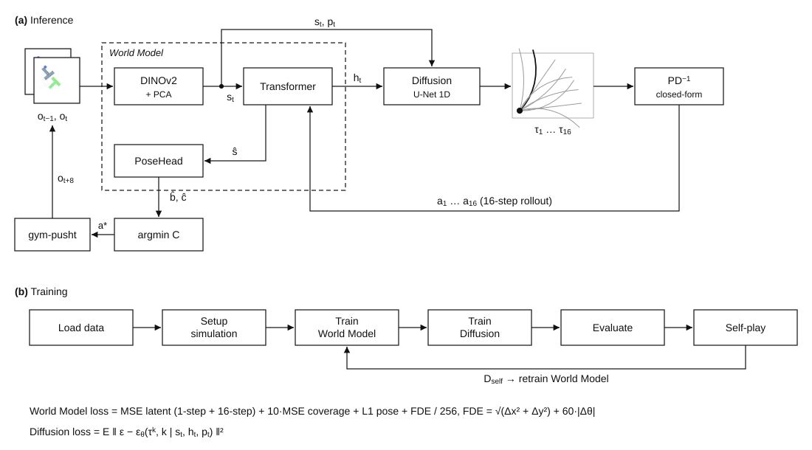
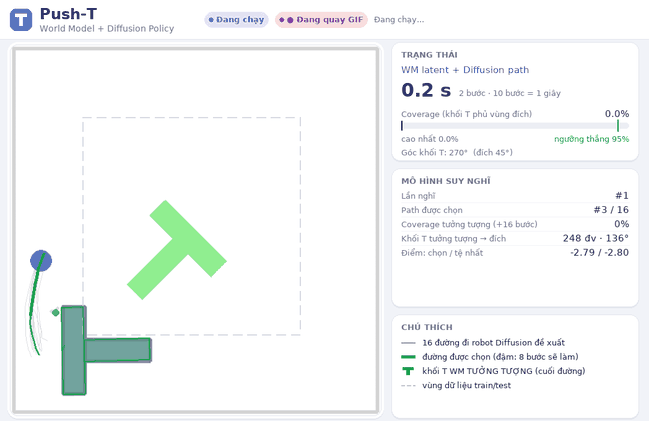

# Mô hình thế giới trong không gian latent cho bài toán đẩy vật Push-T

Project xây dựng một **mô hình thế giới** (world model) học quy luật tương tác giữa robot và vật thể. Từ ảnh quan sát
hiện tại và chuỗi hành động của robot, mô hình dự đoán khối chữ T sẽ dịch chuyển và xoay như thế nào.

Mô hình được ứng dụng để điều khiển robot đẩy khối T vào đích trong môi trường mô phỏng `gym-pusht`, với dữ liệu
`lerobot/pusht`:
- Trạng thái được biểu diễn hoàn toàn bằng đặc trưng ảnh (DINOv2) trong không gian latent.
- Một mô hình Diffusion đề xuất các quỹ đạo cho robot.
- Mô hình thế giới dự đoán hệ quả của từng quỹ đạo và chọn quỹ đạo tốt nhất.

<p align="center">
  
</p>
<p align="center"><em>Sơ đồ hệ thống: (a) suy luận, (b) quy trình huấn luyện lặp với dữ liệu tự chơi.</em></p>

## Kết quả đạt được

| | Kết quả |
|---|---|
| Dự đoán vị trí khối T sau 16 bước (1,6 s) trên tập kiểm tra chưa từng thấy | sai số **3,61 đv**, giảm **87,3%** so với mốc "vật đứng yên" (28,50 đv) |
| Dự đoán góc khối T sau 16 bước | sai số trung vị **0,87°** (mốc đứng yên: 7,48°) |
| Đẩy khối T vào đích, 500 màn kiểm tra | thành công **92,0%**, thời gian trung vị **14,1 s** |
| Cùng hệ, bỏ bước chọn quỹ đạo bằng mô hình thế giới | 84,8%, 17,3 s |

Qua ba vòng huấn luyện có bổ sung dữ liệu tự chơi, cả hai chỉ số đều cải thiện. Sai số dự đoán giảm từ 6,18 → 4,31 →
3,61 đv; tỉ lệ thành công tăng từ 82,8% → 90,6% → 92,0%. Đơn vị đv là đơn vị tọa độ của bàn 512 × 512; khối T cao 120 đv.

<table align="center">
  <tr>
    <td align="center"></td>
    <td align="center"></td>
  </tr>
  <tr>
    <td align="center"><em>Khối T cách đích 247 đv, lệch 135°: thành công sau 19,1 s.</em></td>
    <td align="center"><em>Khối T lệch 180°: thành công sau 17,3 s.</em></td>
  </tr>
  <tr>
    <td align="center"></td>
    <td align="center"></td>
  </tr>
  <tr>
    <td align="center"><em>Bốn màn trong tập kiểm tra.</em></td>
    <td align="center"><em>Kiểu thất bại phổ biến nhất: khối T sát đích (độ phủ 0,94) nhưng chưa đạt ngưỡng 0,95.</em></td>
  </tr>
</table>

Trong ảnh động (phát nhanh gấp đôi):
- đường xám là 16 quỹ đạo do Diffusion đề xuất;
- đường xanh đậm là quỹ đạo được chọn;
- khối T xanh là vị trí mà mô hình thế giới dự đoán sau 1,6 s.

## Phương pháp

- **Mô hình thế giới.**
  - DINOv2 (cố định) và PCA mã hóa ảnh thành trạng thái latent $s_t$ gồm 64 token.
  - Một transformer dự đoán latent của các bước tiếp theo khi biết hành động.
  - Hàm mất mát kết hợp sai số latent với sai số điểm cuối của khối T: $\text{FDE} = \sqrt{\Delta x^2 + \Delta y^2} + 60\,|\Delta\theta|$.
- **Sinh quỹ đạo.** Diffusion (U-Net 1D) nhận $s_t$ và đề xuất 16 quỹ đạo, mỗi quỹ đạo gồm 16 vị trí tương lai của robot.
  Mô hình thế giới được đóng băng trong giai đoạn này.
- **Quỹ đạo → hành động.** Mỗi quỹ đạo được chuyển thành lệnh điều khiển bằng nghịch đảo giải tích của bộ điều khiển PD
  trong mô phỏng, không qua mô hình học.
- **Lựa chọn.** Mô hình thế giới dự đoán 16 bước tương lai cho từng quỹ đạo. Quỹ đạo đưa khối T về đích sớm nhất, hoặc
  gần đích nhất, được thực thi.
- **Huấn luyện lặp.** Các bước: huấn luyện mô hình thế giới → huấn luyện Diffusion → đánh giá → tự chơi 1 000 màn →
  huấn luyện lại.

## Cài đặt và sử dụng

```bash
git lfs install
git clone https://github.com/BuuHuynh12/PushT-World-Model.git && cd PushT-World-Model
python -m venv .venv && source .venv/bin/activate        # Windows: .venv\Scripts\activate
pip install torch torchvision --index-url https://download.pytorch.org/whl/cu126
pip install -r requirements.txt
python app_pusht.py                                       # giao diện mô phỏng tương tác
```

| Lệnh | Mục đích |
|---|---|
| `python app_pusht.py` | Đặt khối T, chạy mô hình, xem các quỹ đạo đề xuất và dự đoán của mô hình thế giới |
| `python scripts/eval_latent_path.py` | Đánh giá trên 500 màn kiểm tra (cần GPU) |
| `python scripts/eval_wm_object.py` | Đánh giá sai số dự đoán của mô hình thế giới (cần GPU) |
| `bash scripts/run_loop.sh` | Huấn luyện toàn bộ quy trình (GPU 24 GB, khoảng 6–7 giờ mỗi vòng) |

Checkpoint nằm trong `models/`. Kết quả gốc của từng vòng huấn luyện nằm trong `results/`.

## Tài liệu tham khảo

1. C. Chi et al., "Diffusion Policy: Visuomotor Policy Learning via Action Diffusion", *RSS*, 2023.
2. G. Zhou et al., "DINO-WM: World Models on Pre-trained Visual Features enable Zero-shot Planning", *arXiv:2411.04983*, 2024.
3. M. Oquab et al., "DINOv2: Learning Robust Visual Features without Supervision", *TMLR*, 2024.
4. D. Ha, J. Schmidhuber, "World Models", *arXiv:1803.10122*, 2018.
